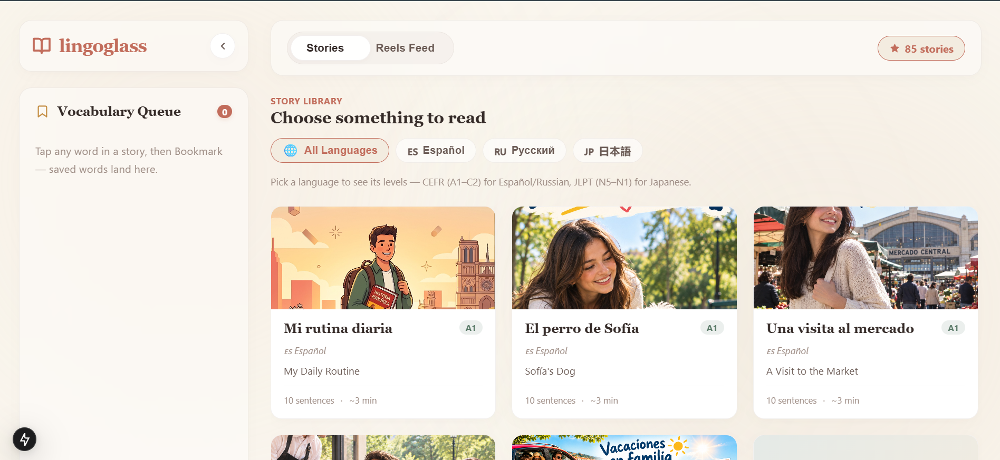

# lingoglass — a reading room of world stories

A calm, editorial reading app for graded language stories: Spanish, Russian (CEFR A1–C2)
and Japanese (JLPT N5–N1). Tap any word for its meaning, listen with native-device
voices, and keep a personal vocabulary queue — all in the browser.



## Features

- **85 graded stories** — 30 Spanish · 30 Russian · 25 Japanese folk tales & essays
- **Tap-to-define words** — every word is clickable, with grammar notes and the sentence translation
- **Japanese tokenization** — native [Sudachi](https://github.com/WorksApplications/Sudachi) morphology
  precomputed at build time (`scripts/precompute-ja.mjs` → committed
  `data/ja-tokens.generated.json`), with romaji readings and an offline English gloss dictionary
- **Read aloud** — neural narration per story (edge-tts) with sentence highlighting and word taps, falling back to the Web Speech API (Woman / Man / Auto voices, 0.5×–1.5×)
- **Vocabulary queue** — bookmark words; they persist in `localStorage` on the device
- **3 reading layouts** — side-by-side, line-by-line, interactive tap-to-reveal (persisted per device)
- **Fully static reading** — all story pages prerendered at build time; no tracking, and no reader accounts (the private operator CMS at `/admin` is separate — see **Admin CMS**)
- **Warm editorial design** — Cream & Clay palette, system fonts only, no CSS frameworks

## Quick start

Requirements: Node.js 18+ · Python 3.10+ (only for Japanese tokenization)

```bash
npm install
cp .env.example .env.local    # SITE_URL for the build (REQUIRED — build fails without it)
pip install -r services/sudachi/requirements.txt  # Japanese tokenizer dict (~1 min, one-time)

npm run dev     # develop at http://localhost:3000
npm run build   # validate content + precompute JA tokens + production build (exit 0 = healthy)
npm start       # serve the production build on :3000
```

Python/Sudachi is only used LOCALLY at build time to regenerate the committed
`data/ja-tokens.generated.json`. If your interpreter isn't on `PATH` as
`python`/`python3`, point to it (see `.env.example`):

```bash
PYTHON=C:\Python314\python.exe
```

Without Python/Sudachi the build still succeeds — Japanese falls back to a
built-in regex splitter (no readings/lemmas).

## Project structure

```text
app/                 Next.js 15 App Router (library, reader, settings, sitemap)
components/          reader (StoryText, WordPopover, AudioPlayer…), library, shell
lib/                 stories parser · bookmarks · progress · tts · story-audio · jmdict gloss · settings
content/             85 story Markdown files (es/ru/ja) — see STORY-FORMAT.md
data/                ja-tokens.generated.json — precomputed Sudachi tokens (committed)
services/sudachi/    standalone Sudachi tokenizer, used LOCALLY at build time only
scripts/             content validator + JA precompute (prebuild) + audio generator (manual)
public/images/stories/  cover photos (optional; placeholders otherwise)
public/audio/        neural narration: {slug}.{hash}.mp3/.json per story + manifest.json
```

## Adding stories

Stories are data, not code — see **[STORY-FORMAT.md](STORY-FORMAT.md)** for the exact
Markdown format, then run `npm run build` to verify.

## Story audio

`npm run audio:generate` synthesizes every sentence with **edge-tts** — Microsoft Edge's
read-aloud endpoint, free and key-less, driven by
[scripts/lib/edge_tts_synth.py](scripts/lib/edge_tts_synth.py) (`python -m pip install --user
edge-tts`) — and writes `public/audio/`: one MP3 per story plus a timing JSON whose
sentence/word offsets come from exact PCM byte lengths (never from player estimates), plus
`manifest.json`. Filenames embed a content hash so they can be cached immutably, and a
deploy serves them as plain static files: no keys, no Python and no ffmpeg on the server.

Per story: each sentence's MP3 (48 kbps CBR, 24 kHz mono) is cached next to its decoded PCM
and its word events under a voice+rate+text key in `.audio-cache/` (gitignored), so an
interrupted run resumes and an edited sentence alone re-synthesizes. The PCM pieces are
joined with 250 ms of silence between sentences and encoded **once**, CBR. Because 48 kbps
CBR is 288 MP3 bytes = 2304 PCM bytes = exactly one 48 ms frame, the voice's own
byte-derived word offsets and the assembled PCM timeline share one grid: no frame drift,
and one encoder pass instead of a per-sentence encode plus a remux. Afterwards `ffprobe` is
asked only to RECONCILE the finished file's length against the PCM that went in (it prints
the drift per story) — it never produces a timing value.

The default rate, `+25%`, is deliberately close to natural: the reader already has a
0.5×–1.5× speed control, and a second speed-up baked into the file would stack under it and
blur exactly the words a learner slows down for. Change it with `--rate` or `EDGE_TTS_RATE`;
the rate is part of every cache key and of the story hash, so changing it re-synthesizes
instead of silently reusing audio.

The reader fetches the manifest on mount and, when the story has audio, plays the MP3 and
highlights sentences from the timing JSON — the player badge then reads **Studio Audio**
(otherwise **Native Audio Sync**, the device voice). Speed control uses `playbackRate`;
seeking sets `currentTime` to the sentence's exact start.

Tapping a word plays just that word's audio. edge-tts says WHEN a word is spoken, never
where it sits in the text, so the generator recovers every word's character range with
`alignWords()` — a forward walk of the sentence, which is what keeps a repeated "no … no"
on its own occurrence — and stores plain UTF-16 spans. A tap is matched to a range by
position, and the MP3 seeks to that word's start and stops at its end. The voice segments
text its own way (Japanese boundaries are phrase-like), so tapping 桃 inside 「桃太郎」 plays
the phrase it was actually spoken in. A word that cannot be located gets no range and falls
back to the device voice; `--show-boundaries` prints the raw events with the range each one
aligned to.

Audio is an enhancement, never a requirement: a missing manifest, a missing entry, sentence
text that no longer matches the audio (story edited without regenerating), a timing JSON
written by an older schema version, or a playback error all fall back to the previous Web
Speech loop, per story.

**Privacy:** generating sends each sentence's text to Microsoft over HTTPS, at authoring time
only. Nothing at runtime talks to Microsoft — readers just fetch static files.

### Trying it without Python or the network: `--fixture`

`npm run audio:fixture` (or `npm run audio:generate -- --fixture`) runs the same pipeline —
same encoder, same silence gaps, same byte-exact timing math, same manifest — but each
sentence is a locally synthesized beep
([scripts/lib/audio-fixture.mjs](scripts/lib/audio-fixture.mjs)) whose word events carry
exactly what edge-tts sends: timing, no character offsets. Only ffmpeg is needed. Fixture
entries carry `"fixture": true` and the reader badges them **Studio Audio · test** instead of
passing beeps off as narration; the fixture voice hashes differently, so a later real run
regenerates rather than skipping, and a real run's files are never deleted by a fixture run.

Useful flags: `--lang es`, `--limit-per-level 1`, `--limit 3` (small batches — the first run
of a changed pipeline should be one), `--only lang/slug[,…]`, `--dry-run`, `--concurrency N`,
`--rate +25%`, `--show-boundaries [n]`. `npm run audio:clear` deletes the generated output.

## Configuration

| Variable             | Default                 | Purpose                                    |
|----------------------|-------------------------|--------------------------------------------|
| `PYTHON`             | `python` → `python3`    | Python interpreter — for the Sudachi script and for `audio:generate` (edge-tts) |
| `SITE_URL`           | `http://localhost:3000` | Canonical URL for `sitemap.xml` — **required in production** (the build fails without it) |
| `EDGE_TTS_RATE`      | `+25%`                  | Speaking rate for `npm run audio:generate` (`--rate` wins); authoring-time only, no key needed — see `.env.example` |
| `FFMPEG`             | `ffmpeg` on PATH        | Path to the ffmpeg binary. A winget/choco/Program Files install is found automatically when PATH does not know it yet (fresh terminal); `FFMPEG` overrides |

Reading, bookmarks, and preferences are anonymous and local-only
(`localStorage`). There are no reader accounts and no network calls for reader data
(the operator-only `/admin` CMS is described under **Admin CMS**).

## Scripts

| Command           | What it does                                      |
|-------------------|---------------------------------------------------|
| `npm run dev`     | Development server                                |
| `npm run build`   | Content validation + JA precompute + static production build |
| `npm start`       | Serve the production build                        |
| `npm run typecheck` | TypeScript check (`tsc --noEmit`)               |
| `npm run lint` | ESLint (`next/core-web-vitals` + TS rules)        |
| `npm test` | Test suite (`vitest run`) — storage, format, audio, admin API/UI and the Phase 6 content-sync round trip |
| `npm run audio:generate` | Neural story audio (authoring-time only; needs Python + edge-tts and ffmpeg — see `.env.example`). Supports `--lang`, `--limit-per-level`, `--limit`, `--only lang/slug`, `--rate`, `--dry-run`, `--concurrency`, `--show-boundaries` |
| `npm run audio:fixture` | Same pipeline, beep audio instead of edge-tts speech (ffmpeg only) — smoke-tests the reader. Add `-- --only lang/slug` etc. |
| `npm run audio:clear` | Deletes the regenerable `public/audio/` output (used to drop fixture beeps before committing) |
| `npm run audio:reconcile` | Manifest ⇄ `content/**` drift check (orphaned/drifted/missing entries; `--prune` removes orphans, `--quiet` for CI-style output) |
| `npm run content:import` | One-time bootstrap: import `content/**` into D1 (and `--covers` uploads cover photos to R2) — see **ADMIN.md** |
| `npm run content:sync` | Export published D1 stories back into `content/**` (a publish does this on the build machine; `--build` skips cleanly without a token) |
| `npm run publish` | Manual publish: `content:sync --remote` → journal → fire `DEPLOY_HOOK_URL` |
| `npm run deploy` | Uploads the built `out/` to Cloudflare Pages (see **Deploy** below) |
| `npm run typecheck:workers` | TypeScript check for Pages Functions (`functions/tsconfig.json`) |
| `npm run dev:admin` | Serve the built `out/` with Pages Functions locally (http://localhost:8788; needs a prior `npm run build`) |
| `npm run db:migrate` | Apply pending D1 migrations to the admin database (`:local` variant for local dev) |
| `npm run admin:create` | Create/rotate the `/admin` account — see **Admin CMS** |

## Deploy

The site is a static export (`out/`) served by Cloudflare Pages as the project
`lingoglass` → https://lingoglass.pages.dev. That project is currently a
**direct upload**, so a push to GitHub runs CI only — deploying is a separate,
deliberate step:

```powershell
$env:SITE_URL = "https://lingoglass.pages.dev"   # .env.local points at localhost, and the
                                                 # sitemap/robots bake this value in
npm run build                                     # validate + JA precompute + static export
npm run deploy                                    # wrangler pages deploy out --project-name=lingoglass
```

`npm run deploy` needs `wrangler` (install it globally, or change the script to
`npx --yes wrangler`) plus a one-time `npx wrangler login`, and it passes
`--commit-dirty=true` so an untracked scratch file can't stall a deploy behind a prompt.
CI on push/PR runs lint, typecheck, tests, content validation, `npm audit` and a build —
it never deploys.

Two things worth keeping in mind:

- **`public/audio/` is committed as ordinary Git blobs, deliberately not Git LFS.**
  `actions/checkout@v4` in CI, and any deploy box, does not fetch LFS objects by default,
  so an LFS-tracked MP3 would arrive as a 130-byte text pointer. The reader would then
  fall back to the device voice and look like it had a timing bug, when it never got audio.
- **`SITE_URL` is build-time, not runtime.** Building with the localhost value in
  `.env.local` produces a working site whose sitemap advertises localhost.

## Admin CMS

A private, operator-only CMS for managing stories lives at **`/admin`**
(https://lingoglass.pages.dev/admin). The reader itself stays fully static and
account-free — this surface exists only for the site operator.

It runs on Cloudflare Pages Functions (`functions/`) with:

- **D1** — `lingoglass-db` (binding `DB`), schema in `migrations/`. Apply with
  `npm run db:migrate` (remote) or `npm run db:migrate:local`.
- **R2** — `lingoglass-media` (binding `MEDIA`) for cover images (Phase 5).
- **`public/_routes.json`** — scopes Functions to `/admin*` and `/api/admin/*` only,
  so every reader page stays zero-invocation static. Don't widen this casually.
- **`functions/_middleware.ts`** — the session gate. It is the *root* middleware on
  purpose: only root-level middleware runs in front of static files, which is what
  makes even `/admin/index.html` unreachable without a session.

Status: **Phases 1–6 complete** — auth schema + `admin:create` bootstrapper; session
gate; login/logout/session APIs with CSRF protection, per-username + per-IP rate
limiting and lockout; the stories CRUD API (below); the story list + editor UI
(`public/admin/`: hash router, filters, optimistic-lock saves); cover-image
upload/manage (R2-backed gallery, magic-byte sniffing); and the publishing
pipeline — per-story publish plus the one-click "Publish site" deploy-hook rebuild.
The day-to-day operator runbook lives in **[ADMIN.md](ADMIN.md)**.

### Stories API (Phase 3)

All under `/api/admin/stories`, session-gated with CSRF (and Origin) checks on
every mutation:

- `GET  /api/admin/stories` — list/filter/search (`lang`, `level`, `status`,
  `q`, `deleted=1`, `limit`/`offset`); returns `nextSlugIndex`, the next `NN`
  prefix suggestion for that lang/level (deleted rows count — an order slot
  never comes back).
- `POST /api/admin/stories` — create a DRAFT with its full content.
- `GET  /api/admin/stories/:id` — metadata + sentences + glossary words.
- `PUT  /api/admin/stories/:id` — full replace; echoes `updatedAt` for an
  optimistic lock (409 `conflict`, response carries the current value) and 409
  `story_deleted` on trashed rows.
- `DELETE /api/admin/stories/:id` — soft delete (trash); `POST .../:id/restore`
  undoes it, idempotently. A slug stays reserved even when deleted — URLs are
  never recycled.
- `POST /api/admin/stories/:id/publish` — flip a draft to published (see
  **Publishing** below).
- Every mutation lands in `audit_log` (`story.create|update|delete|restore|publish`).

What protects the content pipeline: the API validates tighter than the D1
CHECKs (title 200, sentence 1000, surface 80, note 200; ≤200 sentences, ≤50
words per sentence, ≤2000 words per story) and then **round-trips every
payload** — it renders the story with `renderStoryMarkdown()`
(`scripts/lib/story-format.mjs`, the canonical writer shared with the Phase 6
export) and re-parses it with the same primitives the reader uses, rejecting
anything that would not come back identically. Slugs must be lowercase
`NN-basename`: the 2-digit prefix is what keeps `readdirSync().sort()` library
order stable.

Notes worth keeping:

- **Create or rotate the account:** `npm run admin:create -- --remote` (interactive,
  hidden prompt; `--generate` for a random one-time password; `--update` to rotate —
  it also clears `failed_attempts`/`locked_until`/`disabled`, i.e. the early way out
  of a lockout).
- **Secrets stay out of the repo:** `IP_HASH_SALT` (and the Phase 6 `DEPLOY_HOOK_URL`)
  live in the Pages project's dashboard variables (Production scope) or a gitignored
  `.dev.vars` locally — see `.dev.vars.example`.
- **Password hashing:** PBKDF2-SHA256 @ 100 000 iterations (`ADMIN_PBKDF2_ITERATIONS`).
  Measured with `wrangler pages deployment tail` (the `cpuTime` field): ≈24 ms per
  login, ≈38 ms for an unknown username (its timing-equalizing dummy verify) — fine
  on Workers Free despite the documented 10 ms figure. If a CPU error ever appears
  at login: lower the var, redeploy, then re-run `admin:create --update` — existing
  hashes keep verifying because each hash embeds its own cost parameters.
- **Phase 6 note:** publishing regenerates `content/**` from D1
  (`scripts/sync-content.mjs`), which invalidates `public/audio/manifest.json` —
  `tests/story-audio-artifacts.test.ts` asserts the manifest matches the story
  text. `npm run audio:reconcile` reports exactly that drift (orphaned/drifted/
  missing) so audio can be regenerated or pruned in the same session; the build
  never regenerates audio on its own.

### Publishing (Phase 6)

Two distinct buttons, one obvious distinction: **Publish** (a story) marks it
eligible in D1; **Publish site** makes it visible to readers.

- **`POST /api/admin/stories/:id/publish`** — `draft → published` only, on the
  live row (trashed rows 409 `story_deleted`). Idempotent: publishing an
  already-published story is a no-op, not an error. The optional
  `{ updatedAt }` body re-uses the editor's optimistic lock — if the story
  changed since it was loaded, the request 409s instead of publishing stale
  content. `published_at` is COALESCEd, so the first publish date survives
  re-publishes. Lands in `audit_log` as `story.publish`.
- **`GET`/`POST /api/admin/publish`** — the site publish. `GET` returns the
  recent request history; `POST` journals the request (mode + actor in
  `publish_requests`), fires `DEPLOY_HOOK_URL`, and records the hook's outcome.
  A 60 s throttle answers 429 with the previous request so a double click is a
  clear message instead of two builds; a missing `DEPLOY_HOOK_URL` degrades
  gracefully (nothing to fire — the journal entry still records the attempt).

The rebuild itself is where D1 becomes content: the deploy hook runs
`npm run build`, whose prebuild chain is
`sync-content.mjs --build → validate-content.mjs → precompute-ja.mjs`.
`--build` mode is written for machines with **no wrangler login**: it pulls
published stories over the D1 REST API (`CLOUDFLARE_API_TOKEN` +
`CLOUDFLARE_ACCOUNT_ID`) and **skips cleanly when those are unset** — which is
what CI and local builds do, because they use the committed `content/**` instead.
Safety rails before anything is written: a failed D1 pull aborts the build, an
empty published set alongside non-empty D1 rows refuses to touch `content/`
(it would otherwise read as "delete everything"), and unsafe path segments in
`lang/level/slug` are rejected rather than written outside the tree. R2 cover
images ride along into `public/images/covers/`, and drafts/soft-deleted rows are
pruned on export.

`scripts/import-content.mjs` is the one-time bootstrap in the other direction —
`content/** → D1` (batched, skips existing rows unless `--update`, `--covers`
uploads the frontmatter `image:` photos to R2). See **ADMIN.md** for the runbook.

**Current state:** all 85 stories are imported into D1 as `published`, and a
re-export is a verified no-op (`0 written, 85 unchanged`). The publish *pipeline*
is complete and tested end to end, but the `lingoglass` Pages project is still a
direct upload — so the "Publish site" button has no hook to fire yet, and
deploys remain `npm run deploy`. Converting the project to Git-connected is a
deliberate cutover (its name is taken by the live project); **ADMIN.md** records
the steps. Until then `npm run publish` exports D1 → `content/**` and the
operator commits the result by hand.

### Admin UI (Phase 4)

`public/admin/` is a dependency-free ES-module app served through the session
gate (no framework, no build step): `app.js` bootstraps the session + CSRF token
and hosts the hash router (`#/` list, `#/new`, `#/story/:id`), `list-view.js`
renders the filterable/paginated table (filters live in the hash so reload and
Back keep the working set), `editor-view.js` is the metadata + sentence/word
editor, and `story-form.js`/`api.js`/`dom.js` hold the pure form-state⇄payload,
fetch and DOM layers — all covered headless by `tests/admin-stories-ui.test.ts`.
Saves use the optimistic lock: every `PUT` echoes the loaded `updatedAt`, and a
409 conflict reloads the current story instead of overwriting it.

### Cover images (Phase 5)

Images are session-gated under `/api/admin/stories/:id/images`:

- `GET` — the gallery (cover first); `POST` — one raw-body upload per request:
  size cap (`ADMIN_MAX_UPLOAD_BYTES`, default 5 MB) → **magic-byte** sniffing
  (JPEG/PNG/WebP only — the declared `Content-Type` is never trusted) → sha256 →
  R2 object at the content-addressed `covers/<lang>/<level>/<slug>/<sha>.<ext>`
  key → `story_images` row. Identical bytes dedupe onto one row; the first image
  becomes the cover.
- `GET .../:imageId` — the bytes (same-origin, for editor previews);
  `DELETE .../:imageId` — drops the D1 row first, then the R2 object;
  `POST .../:imageId/cover` — promotes an image to THE cover (exactly one per
  story, idempotent). All mutations land in `audit_log`.

